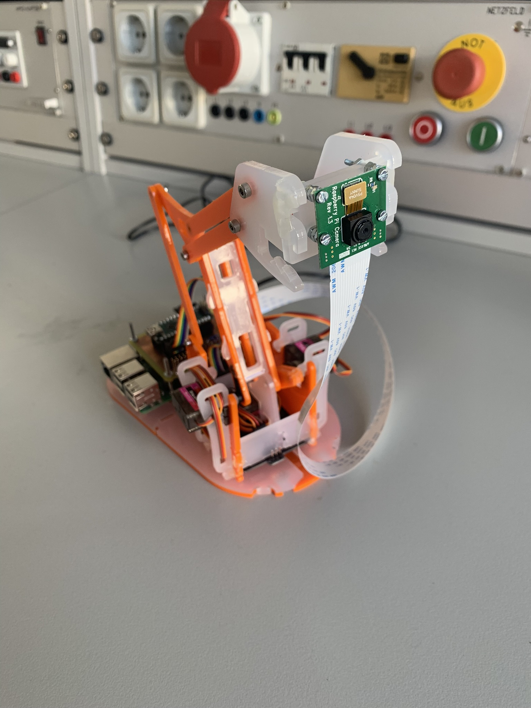
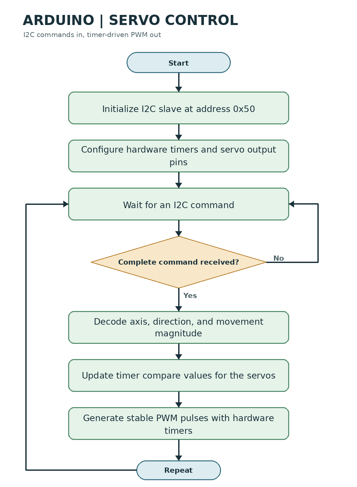
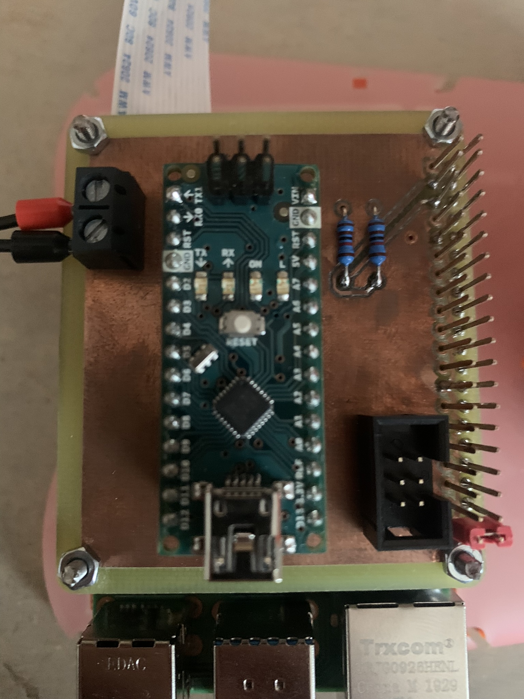

# Robotic Arm Controlled Camera

A Raspberry Pi camera tracks a face and moves a servo-driven robotic arm to keep that face in view. The Raspberry Pi performs camera capture and face detection; an Arduino receives movement commands over I2C and generates the servo PWM signals.



## System Overview

1. The Raspberry Pi captures 640 x 480 camera frames and detects faces with OpenCV.
2. If several faces are visible, it selects the face closest to the previously tracked face.
3. It calculates the selected face's horizontal and vertical offset from the image center.
4. It sends each direction and magnitude to the Arduino over I2C (slave address `0x50`).
5. The Arduino updates hardware timer values to move the servos. A button connected to Raspberry Pi BCM GPIO 21 requests a system shutdown.

### Raspberry Pi Flow


### Arduino Flow



## Why Use an Arduino for Servo PWM?

The Raspberry Pi runs Linux, a multitasking operating system that does not guarantee when a user-space process will run. If software on the Pi bit-bangs servo PWM through GPIO, scheduling delays can shift pulse edges and introduce timing jitter. Servos may respond to that jitter with audible noise, vibration, or imprecise movement.

The Arduino handles the time-critical servo pulses using its hardware timers. Timer peripherals continue producing regular PWM independently of the main program's I2C processing. This separates the Pi's demanding camera and computer-vision work from the precise timing needed to control the servos. The Pi can generate hardware PWM on some pins and configurations, but this project uses the Arduino's timer-driven outputs for servo control.

## Hardware

- Raspberry Pi with a compatible camera module
- Arduino-compatible controller and the servo-control circuit
- Servo-driven robotic arm
- I2C connection between the Raspberry Pi and Arduino
- Momentary shutdown button connected to BCM GPIO 21 and ground

The project photo below shows the custom controller board mounted above the Raspberry Pi.



**Electrical note:** Raspberry Pi GPIO is 3.3 V only. Make sure the I2C bus pull-ups are safe for the Raspberry Pi; use a bidirectional logic-level shifter if the Arduino side pulls the bus up to 5 V. Connect the grounds of both boards.

## Software

The face-tracking program is [`Robotic_arm_controlled_Camera.py`](Robotic_arm_controlled_Camera.py). The Arduino firmware and Atmel Studio project are in [`Arduino_Arm_Conotrol/Roboter_Arm_PWM_SW/`](Arduino_Arm_Conotrol/Roboter_Arm_PWM_SW/).

The Raspberry Pi program requires:

- Raspberry Pi OS with the camera interface enabled
- Python 3
- OpenCV (`cv2`)
- Picamera2
- `smbus2`
- `RPi.GPIO`

Install the Raspberry Pi OS packages for OpenCV, Picamera2, and GPIO using the package manager for your OS release. Install `smbus2` in the Python environment used to run the program. Enable I2C in `raspi-config`, connect the camera and controller, and verify that the Arduino responds at address `0x50` before starting the tracker.

Run the program on the Raspberry Pi with:

```bash
python3 Robotic_arm_controlled_Camera.py
```

Press the shutdown button to request a clean operating-system shutdown. Stopping the script with Ctrl+C also releases the GPIO and closes the camera preview window.

## Notes

- The OpenCV frontal-face Haar cascade is loaded from OpenCV's bundled data directory.
- The camera preview is displayed full-screen. A graphical desktop session is required.
- Servo limits and the mechanical direction of movement depend on the arm and its calibration.
- This project was developed for a specific camera, controller board, and robotic arm; check wiring and servo ranges before powering the motors.
